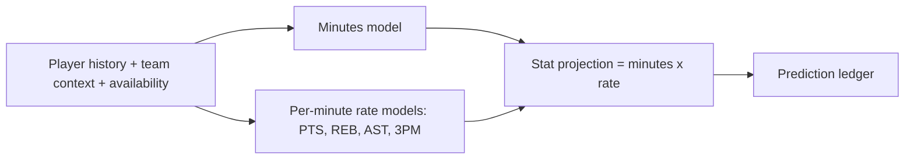
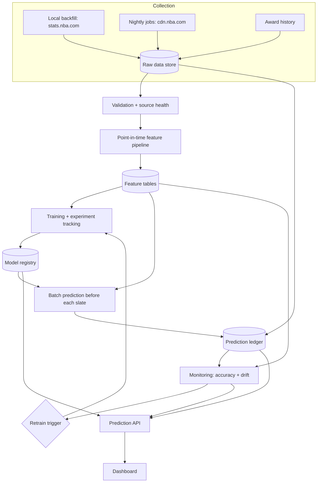

# Project Proposal: NBA Season ML Platform & Dashboard

**Working title:** Courtside ML *(placeholder — final name TBD)* **Document type:** Project Proposal (precursor to the PRD and technical design document) **Version:** 0.1 — Draft **Date:** September 29, 2026 **Author:** Bixzare **Status:** Draft for review **Related documents:** Clash Royale Match Outcome Model (second deployment of this platform)

---

## 1. Purpose of This Document

This proposal defines an end-to-end machine learning system that produces live predictions for the 2026–27 NBA season and presents them in a public dashboard alongside the system's own track record, drift monitoring, and model history. It explains the problem the project addresses, the data strategy, the model families, how the full ML lifecycle is covered, and the phased plan. Detailed requirements and architecture decisions will follow in the PRD and technical design document.

---

## 2. Executive Summary

Most machine learning portfolio projects train a model on a static dataset, report a test-set score, and stop. The later — and in practice harder — stages of the lifecycle (deployment, monitoring on live data, drift detection, retraining, and model governance) are either missing or simulated, because static datasets never produce new labels or change.

This project uses the NBA season as a live, continuously labeled, genuinely drifting environment. Each night, games produce hundreds of new labeled player and team outcomes. Injuries, trades, rotation changes, and rookies shift the underlying patterns throughout the season. The system will:

1. **Predict player game stats** (minutes, points, rebounds, assists, three-pointers made) for every scheduled game, using a minutes-first architecture.
2. **Predict team game outcomes** (winner probability, margin, total points).
3. **Produce a weekly awards ladder** (MVP, Rookie of the Year, Defensive Player of the Year, Sixth Man, Most Improved) estimating voting share from season-to-date performance.
4. **Log every prediction with a timestamp before tip-off** in an immutable prediction ledger, creating a verifiable track record.
5. **Monitor live accuracy and feature drift**, trigger retraining automatically, and promote new models only when they beat the current one.
6. **Present everything in a dashboard** — predictions, results, accuracy over time, drift alerts, model versions, and explanations of why predictions changed.

The system is built as a **domain-agnostic ML platform**: ingestion, feature pipelines, registry, monitoring, and retraining are designed to be reused. The Clash Royale project will be the platform's second deployment.

---

## 3. Background and Motivation

### 3.1 Career Motivation

The project targets two career directions:

- **Sports data analyst / sports data science** — where domain credibility, sound evaluation, and clear communication of insights matter as much as modeling.
- **ML engineering / MLOps** — where demonstrating the full production lifecycle is the key differentiator.

It also connects to the author's existing basketball computer-vision work (Hoop Sync), forming a coherent basketball analytics portfolio narrative.

### 3.2 Why the NBA Is a Strong Environment for a Lifecycle Project

| Requirement for a credible lifecycle project | How the NBA satisfies it |
| --- | --- |
| Continuous new data | Games nearly every night from late October to June |
| Fast ground-truth labels | Box scores final within hours of each game |
| Real, explainable drift | Injuries, trades, role changes, rookie development, the season start itself |
| Meaningful volume | Hundreds of player-game outcomes per night |
| Domain the author understands | Long-standing basketball interest and prior basketball ML work |

### 3.3 Timing

The 2026–27 regular season begins in late October 2026. Historical data can be backfilled at any time, so model development is not time-critical. **A timestamped record of pre-game predictions, however, can only be created live.** A simple baseline predictor should therefore begin logging predictions as close to opening night as possible, even while full models are still in development.

---

## 4. Problem Statement

### 4.1 The Portfolio and Engineering Problem

> Demonstrating production ML competence requires a system that operates on live data, is evaluated against outcomes it could not have seen, detects when it degrades, and recovers automatically. Static-dataset projects cannot demonstrate this.

### 4.2 The User-Facing Problem

Public basketball projections and awards predictions are widely available, but most do not publish a transparent, verifiable record of their past accuracy, rarely explain *why* a projection changed, and never show how the model itself is performing or changing over time. Fans and analysts have no easy way to judge how much to trust a given projection.

This project addresses that with three commitments:

1. **Verifiable track record** — every prediction is logged before the game and compared with the outcome afterward.
2. **Explainability** — projections come with the main factors behind them and what changed since the last one.
3. **Model transparency** — accuracy, calibration, drift, and model version history are part of the public dashboard.

---

## 5. Goals and Non-Goals

### 5.1 Goals

- Cover the complete ML lifecycle on live data: collection, EDA, preprocessing, training, evaluation, deployment, monitoring, and retraining.
- Beat simple, well-defined baselines on every prediction target, and report honestly where it does not.
- Maintain a public, timestamped prediction ledger for the full season.
- Build the platform so it can be reused for a second domain with limited new work.
- Produce analyst-quality output: explanations, clear visuals, and short written insights.

### 5.2 Non-Goals

- **Not a betting product.** No odds, wagering recommendations, or gambling framing.
- **No circumvention of access controls.** The project will not spoof browser fingerprints or otherwise evade bot protection on any data source.
- No live in-game (play-by-play) win probability in v1.
- No proprietary tracking data (player movement, shot tracking) beyond what public endpoints provide.

---

## 6. Intended Audience

- **Hiring managers and technical interviewers** evaluating ML engineering and sports analytics skills.
- **Basketball fans and analysts** interested in transparent projections and awards tracking.
- **The author**, as a working reference implementation for future ML systems.

---

## 7. Data Strategy

### 7.1 Sources

| Data | Source | Access pattern | Notes |
| --- | --- | --- | --- |
| Historical box scores, player and team stats | stats.nba.com via the `nba_api` library | One-time backfill run **locally** | stats.nba.com blocks requests from cloud and data-center IP ranges and applies bot protection; calls from residential connections generally work |
| Nightly schedule, scoreboard, box scores, play-by-play | NBA live endpoints on cdn.nba.com | Automated daily runs from the cloud | One developer report indicates these endpoints are not blocked from cloud IPs; **must be verified in Phase 0** |
| Historical award voting shares | Basketball-Reference | Small, one-time, rate-limited pull | Review Sports Reference terms of use and rate limits before collecting |
| Injury and availability status | To be evaluated (e.g., official NBA injury reports) | Daily | Critical input for minutes prediction; source reliability to be assessed |

### 7.2 Data Principles

- **Compliance first:** respect terms of use and rate limits; no evasion of access controls.
- **Unofficial endpoints are treated as fragile:** each source has health monitoring (records returned, schema changes, empty fields, failures) and alerts.
- **Raw data is retained immutably** so features can be recomputed when definitions change.
- **Point-in-time correctness:** every stored record carries the time it became known, so training never uses information that was not available before a game.

---

## 8. Proposed Solution

### 8.1 Model Family 1 — Player Game Stats

**Targets:** minutes, points, rebounds, assists, three-pointers made, per player per scheduled game.

**Architecture — minutes first:** Minutes played drive almost every counting stat, and minutes are where most real-world uncertainty lives (injuries, rotations, blowouts, rest). The system therefore predicts minutes with a dedicated model, then predicts per-minute production for each stat, and combines the two.

**Candidate features:** rolling per-minute production, recent and season minutes, starter/bench role, teammate availability, opponent defensive profile, pace, home/away, rest days, back-to-backs.

**Baselines:** season average; last-10-game average.

### 8.2 Model Family 2 — Team Game Outcomes

**Targets:** home-win probability, point margin, total points.

**Candidate features:** team ratings, recent form, rest and travel, key player availability, aggregated player projections from Model Family 1.

**Baseline:** an Elo rating system.

### 8.3 Model Family 3 — Awards Ladder

**Targets:** estimated voting share for MVP, Rookie of the Year, Defensive Player of the Year, Sixth Man of the Year, and Most Improved Player.

**Distinct characteristics:**

- Small training data (a limited number of candidates per season across past decades).
- Labels arrive once per year, so live accuracy cannot be monitored.
- Voting reflects narrative as well as statistics; the model is presented as a **stats-based ladder**, not a forecast of voter behavior.
- **Eligibility rules must be encoded.** Since the 2023–24 season, most major individual awards require a minimum number of games played. Ineligible or at-risk players are flagged.

**Validation:** leave-one-season-out backtesting on historical seasons.

**Monitoring substitute:** ladder stability over time and sensitivity to recent games.

### 8.4 The Prediction Ledger

A central, append-only record of every prediction the system makes:

- Prediction target, value, and (where applicable) probability or interval
- Timestamp, which must precede the game's tip-off
- Model name and version, feature snapshot reference
- Outcome and error, filled in after the game

The ledger is the basis for all live accuracy metrics and the project's credibility. Records are never edited after creation; corrections are new records.

### 8.5 Dashboard

| View | Contents |
| --- | --- |
| **Tonight** | Upcoming games; team outcome predictions; player stat projections with explanations |
| **Results** | Last night's predictions against actual outcomes |
| **Track record** | Accuracy and calibration over the season, by target, compared with baselines |
| **Player page** | Projection history, actual results, main drivers, role/minutes trend |
| **Awards ladder** | Weekly ladder with movement, eligibility status, and main drivers |
| **Model health** | Live accuracy trend, feature drift, source health, active alerts |
| **Model registry** | Version history, retraining events, champion vs. challenger results, promotion decisions |
| **Insights** | Short written weekly notes on notable trends and model behavior |

---

## 9. ML Lifecycle Coverage

| Stage | Implementation |
| --- | --- |
| **Data collection** | Local historical backfill; automated nightly collection; source health monitoring |
| **EDA** | Published notebooks: minutes distributions, role stability, home/away and rest effects, variance by player type, awards history |
| **Preprocessing & features** | Point-in-time feature pipeline; rolling windows; availability handling; versioned feature definitions |
| **Training** | Gradient-boosted models as primary; linear and baseline models for comparison; experiment tracking |
| **Evaluation** | Walk-forward backtests; comparison with baselines; error broken down by minutes band, role, and team; calibration for probabilities |
| **Deployment** | Scheduled batch predictions before each slate; prediction API; dashboard |
| **Monitoring** | Live accuracy from the ledger; feature drift; prediction distribution shift; source health |
| **Retraining** | Scheduled and drift-triggered retraining; champion/challenger evaluation; automated promotion with logged decisions |

---

## 10. Monitoring and Retraining Policy

### 10.1 Signals

- **Performance:** rolling live error (e.g., 7-day and 30-day MAE per stat; Brier score for win probability) compared with the model's backtested expectations and with baselines.
- **Feature drift:** distribution shift in key inputs (e.g., minutes distributions, pace, usage) against the training window.
- **Prediction drift:** shift in the distribution of the model's own outputs.
- **Data quality:** missing games, schema changes, unexpected nulls.

### 10.2 Triggers

- **Scheduled:** periodic retraining on a rolling window (cadence to be determined, e.g., weekly).
- **Drift-triggered:** retraining when performance or drift signals cross defined thresholds.
- **Event-aware annotation:** major events (trade deadline, All-Star break, season start) are recorded so drift can be interpreted in context.

### 10.3 Promotion

A retrained challenger replaces the current champion only if it outperforms it on a held-out recent window by a predefined margin, without degrading calibration. Every promotion or rejection is logged with its evidence and shown in the dashboard.

### 10.4 Offseason

Between the end of the playoffs and the next season, the system shifts to backtesting, model redesign, and a full retrain. Extending to the WNBA (roughly May to October) is a possible later option to maintain live operation year-round, subject to data availability.

---

## 11. Evaluation Plan

- **Walk-forward backtesting:** train only on data before each evaluation date, predict forward, and roll the window — mirroring live operation.
- **Baselines for every target:** season average and last-10 average (player stats); Elo (team outcomes); prior-season leaders (awards).
- **Metrics:** MAE per stat, overall and by minutes band; Brier score and log loss for win probability; MAE for margin and total; rank accuracy for awards backtests.
- **Calibration:** reliability plots for all probability outputs.
- **Error analysis:** where the model is worst (e.g., low-minute players, players returning from injury) is reported, not hidden.
- **Honest reporting:** results are published even where the model does not beat a baseline.

### 11.1 Leakage Rules

- Only information available before tip-off may be used for a prediction.
- Rolling features are computed strictly from prior games.
- Availability data uses the status known at prediction time, not after.
- Season-level statistics used in backtests are reconstructed as of each date, never taken from end-of-season totals.

---

## 12. Proposed Architecture

### 12.1 Candidate Stack (Free-Tier Oriented)

| Concern | Candidate |
| --- | --- |
| Language | Python |
| Storage | PostgreSQL (e.g., Supabase free tier) or DuckDB + Parquet |
| Orchestration | GitHub Actions scheduled workflows or Prefect |
| Modeling | LightGBM / XGBoost, scikit-learn |
| Experiment tracking & registry | MLflow |
| Drift monitoring | Evidently |
| Explainability | SHAP |
| Serving | FastAPI on a free hosting tier |
| Dashboard | Next.js or Streamlit |
| Testing & CI | pytest, data validation tests, GitHub Actions |

Final choices will be made in the technical design document.

### 12.2 Platform Design for Reuse

Core components are domain-agnostic and configured per domain:

- **Source adapter interface** (fetch, validate, store)
- **Feature pipeline framework** with point-in-time guarantees
- **Model registry, ledger, monitoring, retraining, and promotion logic**
- **Dashboard components** for track record, model health, and registry

Domain-specific code is limited to source adapters, feature definitions, targets, and domain views. The Clash Royale project will validate this design.

---

## 13. Scope

### 13.1 v1

- Local historical backfill and nightly automated collection
- Player stat projections (minutes-first) and team outcome predictions
- Prediction ledger with pre-tip-off timestamps
- Baselines, walk-forward evaluation, calibration
- Drift and accuracy monitoring; automated retraining with champion/challenger promotion
- Dashboard: Tonight, Results, Track record, Player page, Model health, Model registry

### 13.2 v1.5

- Awards ladder with eligibility handling and historical backtests
- Weekly written insights
- Expanded explanations (what changed since the last projection)

### 13.3 Later

- Second domain deployment (Clash Royale)
- WNBA extension for year-round operation
- Playoff-specific models
- Integration with Hoop Sync shot data

### 13.4 Out of Scope

- Betting features or odds
- In-game live win probability (v1)
- Evasion of access controls on any data source

---

## 14. Phased Delivery Plan

| Phase | Focus | Target timing |
| --- | --- | --- |
| **0 — Access spike** | Verify cloud access to live endpoints; confirm local backfill works; select injury source | Immediately |
| **1 — Baseline ledger** | Nightly collector plus baseline predictor logging timestamped predictions | By opening night, or as soon after as possible |
| **2 — Backfill & EDA** | Historical backfill, point-in-time tables, published EDA | Early season |
| **3 — Models v1** | Minutes model, stat rate models, team outcome model, walk-forward evaluation | Early season |
| **4 — MLOps loop** | Registry, monitoring, drift detection, retraining, promotion | Early to mid season |
| **5 — Dashboard** | Public dashboard with all v1 views | Mid season |
| **6 — Awards & insights** | Awards ladder, weekly insights | Mid season onward |
| **7 — Second domain** | Clash Royale deployment on the platform | After v1 is stable |

Project Horizon v2 remains the first priority; Phases 0–1 are small enough to run in parallel because the prediction record can only be built live.

---

## 15. Measures of Success

**Predictive quality**

- Player stats: lower MAE than both baselines across the season, per stat
- Team outcomes: better Brier score than Elo; well-calibrated probabilities
- Awards: strong rank accuracy in historical backtests

**Operational quality**

- Every prediction logged before tip-off for the full season
- Nightly pipeline success rate; source failures detected and alerted
- At least one documented drift event with detection, retraining, and recovery

**Portfolio and communication**

- Public dashboard with a season-long track record
- Documented architecture, decision records, and evaluation methodology
- Regular written insights demonstrating analyst-style communication

---

## 16. Risks and Mitigations

| Risk | Mitigation |
| --- | --- |
| Live endpoints blocked from cloud or changed without notice | Phase 0 verification; source health monitoring; fallback of running collection from a local machine |
| Missing opening night | Backfill covers history; begin the ledger as soon as possible and state its start date clearly |
| Unreliable injury/availability data | Treat availability as uncertain input; measure minutes-model error by availability status |
| Leakage inflates backtests | Point-in-time feature store; explicit leakage tests |
| Too many targets for available time | v1 limited to player stats and team outcomes; awards deferred to v1.5 |
| Model underperforms baselines | Report honestly; analyze why; this is still valid evaluation evidence |
| Terms-of-use issues with data sources | Review terms per source; rate limiting; no circumvention |
| Heavy use of AI coding tools weakens understanding | Author owns modeling and evaluation decisions and documents them in decision records |
| Hosting limits on free tiers | Batch predictions rather than real-time serving; static dashboard generation where possible |

---

## 17. Open Questions

1. Which injury/availability source is reliable enough to support the minutes model?
2. Should player projections be point estimates or include prediction intervals in v1?
3. What drift thresholds and retraining cadence balance responsiveness with stability?
4. What promotion margin should a challenger need to replace the champion?
5. How should the ledger handle games postponed after predictions are made?
6. Should the dashboard be Streamlit for speed or Next.js for polish and consistency with other projects?
7. Is WNBA data accessible in the same way, making year-round operation feasible?

---

## 18. Next Steps

1. Run the Phase 0 access spike.
2. Stand up the baseline ledger before or shortly after opening night.
3. Write the PRD: requirements per model family, ledger specification, dashboard views, monitoring and promotion rules.
4. Write the technical design document: storage, orchestration, platform interfaces for reuse, and hosting.