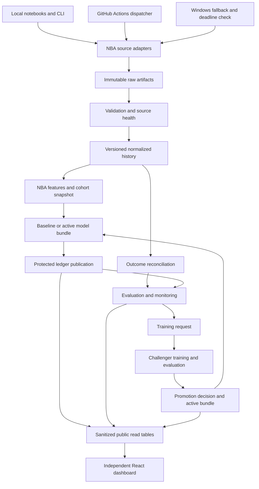

# Baseline: Technical Design

Status: LOCKED by the project owner on October 12, 2026, with approved amendments through October 14, 2026. This approves the design; implementation and runtime verification remain outstanding.

Version: 1.5

Prepared: October 12, 2026

Requirements: [locked PRD v1.1](PRD.md) and [locked critical path](critical-path.md). The [locked notebook amendment](PRD-notebook-amendment.md) and [locked awards eligibility and validation amendment](PRD-awards-eligibility-amendment.md) were incorporated into PRD v1.1 when this design was locked.

This is a design, not an implementation or a claim of verified runtime access. No repository has been published, cloud resource provisioned, or NBA access probe executed as part of this planning work.

## 1. Decisions and scope

The owner confirmed these design choices after locking the PRD:

- One public source repository, with separate Python platform and NBA modules and an independently deployed dashboard.
- Supabase Postgres for operational records and recent normalized history; compressed immutable files for raw inputs, feature snapshots, and model artifacts.
- A local historical archive with a separate backup; cloud-required artifacts in private object storage.
- The same Python command-line operations underneath notebooks, GitHub Actions, and Windows Task Scheduler.
- Database-enforced ledger permissions, uniqueness, and publication checks, with separate migration credentials.
- Publication receipt approved October 12, 2026: commit each immutable batch, then confirm its visibility in a separate database transaction before the cutoff. Retry confirmation of the same batch only; missing or late confirmation leaves it unverified and reported as a coverage failure.
- Database approach approved October 12, 2026: psycopg with explicit SQL, ordered SQL migration files introduced by phase, separate platform and NBA schemas, and sanitized public data with read-only permissions. Prefer direct connections where available; verify the session pooler as the IPv4 fallback, including migrations and backup/restore.
- A React/Vite dashboard using strict TypeScript and Tailwind CSS v4, reading a deliberately exposed Supabase API; no separate FastAPI service initially.
- Frontend components approved through ADR 0010: shadcn/ui for core controls and tables, with selective free Magic UI or Aceternity additions for polish. Share Baseline design tokens and verify copied source, licenses, compatibility, and accessibility.
- Dashboard hosting approved October 12, 2026: GitHub Pages for initial testing, then Vercel as the planned public host subject to deployment checks. Lovable is optional for generating the initial UI shell. No paid plan is approved.
- Python 3.12, uv, Ruff, mypy, pytest, and a project Jupyter kernel, subject to dependency installation verification.
- Nightly collection at 07:17 UTC; a dispatcher every 15 minutes; local deadline monitoring and fallback.
- Essential schedule/status evidence no older than 30 minutes and roster evidence no older than 24 hours at publication.
- GitHub workflow failure emails plus Windows desktop alerts for the independent local checker.
- Local development training, with automated cloud training enabled only after runtime and memory measurements.
- Cloud training gate approved October 12, 2026: rehearse the complete training, evaluation, and report-upload cycle on the actual GitHub Actions runner with one candidate configuration and bounded CPU threads. Enable scheduled training only after reliable completion within available free resources; otherwise reduce the workload or use the same command through the local scheduler with machine availability documented.
- Experiment tracking approved October 12, 2026: local MLflow for development comparisons; automated run summaries, evaluation results, model versions, and promotion decisions in Supabase, with detailed reports in immutable artifact storage. Shared run IDs and artifact references connect the two interfaces.
- Challengers trained before a recent 30-day evaluation window, with the exact tested artifact deployed after passing gates.
- Player promotion groups based on the same baseline minutes prediction: below 10, 10 to below 25, and at least 25 minutes.
- Extra training requests after three daily checks with 30-day primary loss greater than 1.05 times baseline loss, on matched observations and at least 100 distinct games; a seven-day extra-run cooldown.
- Feature-drift alert thresholds calibrated using historical reference periods, rather than arbitrary default severity labels.
- An existing cloud-synced folder for the independent database and artifact backup; provider and local path are supplied during setup.
- Backup policy approved October 12, 2026: daily database and required-artifact backups to that folder, an alert when the latest verified off-device backup is more than 24 hours old, and a restore rehearsal into an isolated database before launch. Verify forecast records, timestamps, artifact hashes, and counts; report unrecoverable gaps honestly.
- Storage policy approved October 12, 2026: warn at 60% of an included storage allowance or when projected season growth exceeds it; pause optional shadow runs and additional reports at 80%. Preserve official forecasts and required evidence, and verify actual provider allowances during setup.
- Student benefits policy approved October 12, 2026: GitHub Student Developer Pack benefits remain optional and add no dependency to Phases 0 and 1. Any later adoption records eligibility, expiry, renewal cost, and a replacement path.
- Team baseline policy approved October 12, 2026: fixed Elo settings and last-10 team scoring/conceding formulas in Section 9.2. These are initial benchmarks, not tuned performance claims, and follow the player baseline launch.
- Calibration approach approved October 12, 2026: five fixed equal-width home-win probability bins, with per-bin mean prediction, observed win frequency, and counts. Use sample-weighted absolute calibration error alongside the existing Brier-primary and log-loss/calibration regression guards.
- Historical comparison display approved October 12, 2026: numeric targets show predicted/actual values and signed/absolute errors; games show the predicted winner/probability and actual result; weekly awards snapshots are compared with verified eventual winners. Observed error is distinct from prediction uncertainty, and intervals remain deferred.
- Player evaluation fallback approved October 12, 2026: if historical roster and DNP reconstruction is insufficient, retain the baseline as official while collecting prospective roster/outcome evidence. Candidates may train and run in shadow mode; promotion still requires the full cohort, temporal, sample, coverage, and performance gates.
- Awards release policy approved October 12, 2026: each published ladder requires three complete chronological evaluation seasons, a predefined award-specific benchmark, NDCG at five using verified final voting points, and the eventual winner's rank at comparable season checkpoints. Insufficient verified evidence blocks the affected award's release.

The following sections supply the approved implementation design. They do not add a requirement to build future phases before opening night. Exact package versions are pinned by the coding agent after the installation smoke test, not guessed in this document. Candidate sources and explicitly gated later choices remain subject to their stated verification requirements.

## 2. Architecture and data flow

Everything is batch work. There is no continuously running Python API, message broker, feature-store service, or hosted MLflow server in the initial design. A notebook executes the same functions as a scheduled command, with different configuration and credentials.

Prediction publication, result collection, and training have separate runs and failure states. A failed training job cannot stop the current champion from producing forecasts. A broken required data source can stop the affected forecast deliberately.

## 3. Repository and boundaries

| Path | Responsibility |
| --- | --- |
| src/hoop/platform/ | Artifact manifests, run records, source contracts, database access, ledger, evaluation interfaces, monitoring, training requests, and promotion records. |
| src/hoop/domains/nba/ | NBA adapters, schedule and roster interpretation, normalization, features, baselines, model specifications, evaluation groups, and award rules. |
| src/hoop/cli.py | Thin command entry points; delegates to platform and NBA operations. |
| notebooks/ | The six walkthroughs specified by the notebook amendment. |
| configs/ | Versioned non-secret baseline, source, feature, evaluation, and orchestration policy settings. |
| migrations/ | Ordered SQL migration files, including grants, publication functions, and public read tables. |
| tests/unit/, tests/integration/, tests/leakage/ | Pure logic, real Postgres constraints, and information-cutoff tests. |
| tests/notebooks/, tests/fixtures/ | Small rehearsal inputs and notebook execution checks without live NBA requests. |
| dashboard/ | React/Vite TypeScript application with Tailwind v4, its own dependency lockfile, and deployment workflow. |
| docs/decisions/ | Short reviewed ADRs. |
| data/, artifacts/, .env | Local working data and configuration, excluded from Git. |

Platform code must not import NBA modules. It receives explicit objects describing an event, subject, target, feature manifest, or metric. NBA adapters supply those objects. The platform does not know what a rebound, NBA season, or award is.

Use a small set of explicit contracts: source fetch/validate/normalize, feature construction at a cutoff, prediction from a model bundle, target outcome extraction, and evaluation. Do not build dynamic plugin discovery. Test reuse with one small synthetic non-NBA domain; implement Clash Royale later.

Use pandas for ordinary tabular work and Parquet for durable analytical tables. DuckDB is an optional local query tool for the Parquet archive, not a second operational database. Use psycopg for explicit Postgres operations; add no ORM at launch. Dependency versions and available drivers must pass Windows and Linux smoke tests.

## 4. Source adapters and access gates

| Capability | Candidate | Verification required before activation |
| --- | --- | --- |
| Historical game logs | nba_api LeagueGameLog for player and team regular-season records, locally. | Season coverage, identifiers, minutes precision, totals, null handling, and resumability. |
| Historical detailed box scores | A supported nba_api stats endpoint, locally, only where game logs lack required fields. | Exact fields, revision behavior, and request budget. Do not fetch a detailed endpoint for every game without a demonstrated need. |
| Current scoreboard/status | nba_api live ScoreBoard. | Actual cloud and local access, timestamps, no-game behavior, and source day interpretation. |
| Final live box scores | nba_api live BoxScore by stored game ID. | Final status, player participation, minute precision, team totals, and late correction behavior. |
| Future schedule | A documented schedule adapter or permitted CDN schedule resource. | Season coverage, UTC starts, unscheduled slots, postponements, and stable source IDs. Today's scoreboard alone does not pass this gate. |
| Current rosters | A verified NBA roster resource; CommonTeamRoster is a local stats candidate. | Team membership, season, identity joins, trade changes, and timestamps. Static player lists are not sufficient. |
| Availability | Official injury reports, if dependable. | Target-season source, publication times, parser accuracy, and permitted automated access. Otherwise explicitly defer. |
| Award labels and rules | NBA official releases/rule documents first; other proposed sources only after review. | Complete candidate and voting coverage, historical rules, source permission, and reproducible snapshots. |

Candidate endpoints are not accepted sources until the spike passes. Package interfaces are documented in [nba_api](https://github.com/swar/nba_api), including [LeagueGameLog](https://github.com/swar/nba_api/blob/master/docs/nba_api/stats/endpoints/leaguegamelog.md), [ScoreBoard](https://github.com/swar/nba_api/blob/master/docs/nba_api/live/endpoints/scoreboard.md), and [BoxScore](https://github.com/swar/nba_api/blob/master/docs/nba_api/live/endpoints/boxscore.md).

Initial request policy: sequential requests per source, a configurable three-second minimum gap, a 30-second timeout, and at most two retries for temporary network or server errors. These are conservative project settings, not a verified NBA allowance. Honor a longer Retry-After. Access-denied or bot-challenge responses stop that source's run and alert; do not loop, change identity, or evade protection. Lower the request volume if observed behavior requires it.

Persist the raw body before normalization. Store every fetch result's metadata; identical body content can reuse a content-addressed object. Quarantine failed validation without feeding it into features. Bulk backfills checkpoint per season or chunk, so reruns continue from saved evidence.

Use a separate accepted-source configuration per environment. Cloud failure selects the tested local path. An endpoint failing everywhere requires a different permitted source, not merely moving the same failing call to Windows. If a roster or schedule capability remains unavailable, report the gate as failed and return to the owner for a coverage decision.

## 5. Storage and identifiers

Use private Supabase Storage for files required by cloud work, with content-addressed keys and overwrite disabled for accepted artifacts. Keep raw data, history exports, feature snapshots, models, and reports in separate prefixes. The artifact manifest is the authority for format, checksum, schema, code version, and provenance.

Runtime storage access, approved in [ADR 0012](decisions/0012-restrict-runtime-artifact-storage-access.md) on October 13, 2026: use a dedicated backend Auth identity with read/create permissions bound to its verified ID and private artifact bucket. Deny replacement, deletion, moves, bucket administration, and unrelated-bucket access. Database operations retain their separate restricted psycopg role; neither runtime path grants private Data API access or direct Storage metadata mutation. Administrator credentials stay outside ordinary jobs. Keep job sessions in memory, verify renewal and independent concurrent sessions, and fail dependent operations when authentication or artifact verification fails. This adds an Auth dependency without a new server or dashboard accounts. Identity setup, migrations, hosted enforcement, and recovery remain execution gates.

Keep the full local historical archive outside Git, with an independently stored backup. Upload only historical partitions needed for the active training window and recent prediction history after measuring size. Runtime jobs must never depend on an unreferenced file available only on the owner's laptop.

At launch, seed recent normalized player and team history sufficient for the last-10 baselines in Postgres. Keep the full 2025-26 seed in the historical archive. Retain all observed current-season normalized facts needed for outcome reconciliation and current-season baselines. Raw and feature payloads remain in object storage rather than repeated in every prediction row.

IDs: use UUIDs for platform records, strings for external NBA IDs, UTC timestamptz for observed and decision times, and date only for explicitly defined season or reporting dates. Keep NBA source game ID separate from a platform event occurrence ID. A postponement creates a new occurrence linked to its predecessor; a normal schedule correction appends an observation to the existing occurrence.

For each source value distinguish event time, source publication time when available, ingestion time, and validation time. A historical availability assumption is a separate labeled field. Never fill an absent historical publication time with today's ingestion time and call it historical evidence.

Free-tier capacity is a gate: measure table and index growth, compressed artifacts, versions, and egress from representative workloads. Supabase documents a 500 MB free database allowance and 1 GB of object storage, so fitting a season is not assumed. [Database size](https://supabase.com/docs/guides/platform/database-size), [Storage pricing](https://supabase.com/docs/guides/storage/pricing).

## 6. Logical database schemas

The following specifies the initial logical tables and constraints. Implement them in stage-specific migrations, not all at once. UUID keys are primary keys; references to another table's ID are foreign keys unless explicitly identified as external source IDs. Required fields are non-null unless described as optional. Configuration enums and schema versions are versioned in code and migrations.

### 6.1 Platform operations and evidence, Phases 0-1

| Table | Columns and constraints |
| --- | --- |
| platform.runs | run_id UUID; operation, domain, environment, code_version, config_hash TEXT; started_at TIMESTAMPTZ. Environment separates rehearsal from production. |
| platform.run_events | run_event_id UUID; run_id; recorded_at TIMESTAMPTZ; state TEXT; reason_code TEXT optional; details JSONB sanitized. Append transitions; terminal events record counts and duration. |
| platform.artifacts | artifact_id UUID; sha256 TEXT; kind, format, schema_version TEXT; byte_count BIGINT; created_at TIMESTAMPTZ; storage_uri TEXT; manifest JSONB. Unique storage URI; digest checked on reads. No credentials in URI. |
| platform.source_checks | check_id UUID; run_id; source_id, adapter_version TEXT; requested_at TIMESTAMPTZ; received_at TIMESTAMPTZ optional when no response arrives; validated_at TIMESTAMPTZ optional on failure; source_published_at TIMESTAMPTZ optional; raw_artifact_id optional on failure; http_status INT optional; state TEXT; record_count INT optional; validation_summary JSONB. Attempt completion is recorded in a run event. Failure is not zero returned records. Accepted inputs require known ingestion and successful validation by their feature cutoff. |
| platform.events | event_id UUID; domain, source_event_id, competition, season TEXT; occurrence_no INT; predecessor_event_id optional; created_at TIMESTAMPTZ. Unique domain/source_event_id/occurrence_no. |
| platform.event_observations | observation_id UUID; event_id; source_check_id; observed_at TIMESTAMPTZ; scheduled_start TIMESTAMPTZ optional; actual_start TIMESTAMPTZ optional; state TEXT; details JSONB. Append-only. Unknown times are not fabricated. |
| platform.models | model_id UUID; domain, family, target, version TEXT; code_version, config_hash TEXT; artifact_id optional for deterministic baselines; training_cutoff TIMESTAMPTZ optional; created_at TIMESTAMPTZ. Unique domain/family/target/version. Baseline configurations have versions too. |
| platform.model_bundles | bundle_id UUID; domain TEXT; components JSONB mapping targets to model IDs; created_at TIMESTAMPTZ; config_hash TEXT. Validate every referenced model exists before insertion; immutable. |
| platform.active_bundles | domain and family TEXT composite key; bundle_id; generation BIGINT. Mutable pointer, changed only through controlled activation and a matching audit event. Seed baseline activation by migration or controlled bootstrap operation. |
| platform.alert_events | alert_event_id UUID; alert_key, severity, state TEXT; observed_at TIMESTAMPTZ; run_id optional; report_id optional; details JSONB. Append open, acknowledgment, and resolution events. Add the evaluation-report foreign key when that table is introduced. |

Mutable convenience pointers are not prediction evidence. Current state can be rebuilt from immutable facts and decision history. Record baseline bootstrap activation in a run event initially; the MLOps migration adds dedicated activation records and preserves that bootstrap provenance.

### 6.2 NBA facts, Phases 0-1

| Table | Columns and constraints |
| --- | --- |
| nba.teams | team_id TEXT primary key; display_name TEXT; abbreviation TEXT. Display labels are mutable; identities are stable. |
| nba.players | player_id TEXT primary key; display_name TEXT. Do not use a name as the join key. |
| nba.games | event_id primary/foreign key to platform.events; home_team_id, away_team_id; source_season_type TEXT. Teams must differ. |
| nba.roster_snapshots | roster_id UUID; team_id; season TEXT; source_check_id; validated_at TIMESTAMPTZ; members_artifact_id. Membership rows live in a versioned artifact to avoid repeated large roster tables. |
| nba.player_game_versions | fact_id UUID; event_id; player_id; team_id; source_check_id; observed_at TIMESTAMPTZ; evidence_tier TEXT; participation TEXT; minutes_seconds NUMERIC optional; points, rebounds, assists, threes_made INT optional; started BOOLEAN optional. Unique event/player/source revision. Null means unknown; validated DNP is an explicit participation state with zero outcomes. |
| nba.team_game_versions | fact_id UUID; event_id; team_id; source_check_id; observed_at TIMESTAMPTZ; evidence_tier TEXT; points_for, points_against INT; extras_artifact_id optional. Unique event/team/source revision. |

Versioned facts are append-only; current facts are derived from the latest accepted revision, while historical features select the revision available at their cutoff. Raw payloads retain optional fields that are not normalized yet. Add typed feature columns through migrations only when a model needs them.

### 6.3 Forecasts and outcomes, Phase 1

| Table | Columns and constraints |
| --- | --- |
| platform.forecast_batches | batch_id UUID; run_id; event_id; bundle_id; feature_artifact_id; cohort_artifact_id; schedule_observation_id; generated_at, feature_cutoff, recorded_at TIMESTAMPTZ; scheduled_start TIMESTAMPTZ; publication_policy_version TEXT; content_hash TEXT; insertion_transaction_id TEXT. Snapshot includes all source and roster references, expected subjects/targets, and history counts. |
| platform.predictions | prediction_id UUID; batch_id; subject_type, subject_id, target, role TEXT; model_id; value DOUBLE PRECISION; unit TEXT. Unique batch/subject/target/role. Reject nonfinite or out-of-domain values. |
| platform.abstentions | abstention_id UUID; batch_id; subject_type, subject_id, target, role, reason_code TEXT; details JSONB. Unique batch/subject/target/role. A batch cannot contain both prediction and abstention for the same slot. |
| platform.official_slots | event_id, subject_type, subject_id, target composite key; batch_id; decision_kind TEXT, either prediction or abstention. Reserved atomically at first official attempt. Child event/batch/subject/target/kind must agree; exactly one matching child is required at transaction completion. No replacement values after publication; retry must reference the same content. |
| platform.publication_receipts | receipt_id UUID; batch_id unique; observed_committed_at TIMESTAMPTZ; confirming_transaction_id TEXT; policy_version TEXT. Created only through the separate visibility-confirmation operation described below. |
| platform.prediction_events | prediction_event_id UUID; batch_id; prediction_id optional; recorded_at TIMESTAMPTZ; kind, reason_code TEXT; source_check_id optional. Postponement, invalidation, or audit correction appends a record. |
| platform.outcome_versions | outcome_version_id UUID; event_id; observed_at TIMESTAMPTZ; source_check_id; outcome_artifact_id; state TEXT. Artifact contains subject/target values and references the normalized revisions that justify them. Never overwrite prior outcomes. |
| platform.evaluation_reports | report_id UUID; domain, report_kind, policy_version TEXT; period_start, period_end, created_at TIMESTAMPTZ; predictions_manifest_id; outcomes_manifest_id; report_artifact_id; summary JSONB containing counts and primary metrics. Separate live, replay, and rehearsal reports. |

Store detailed errors and analytical slices in a report artifact rather than duplicating every prediction into a second large database table. Public read tables may denormalize selected results; they are reproducible projections, not authoritative evidence.

### 6.4 MLOps additions, remaining v1

| Table | Columns and constraints |
| --- | --- |
| platform.training_requests | request_id UUID; domain, component, trigger_kind TEXT; requested_at TIMESTAMPTZ; dedup_key TEXT unique; policy_version TEXT; evidence_report_id optional. |
| platform.training_runs | training_run_id UUID; request_id; run_id; train_manifest_id, development_manifest_id; training_cutoff TIMESTAMPTZ; model_id optional until complete; result_artifact_id optional. Completion is recorded by run events. |
| platform.promotion_decisions | decision_id UUID; decided_at TIMESTAMPTZ; component TEXT; champion_bundle_id; challenger_model_id; evaluation_report_id; policy_version TEXT; result, reason_code TEXT; gates JSONB. Record rejection and insufficient evidence as well as success. |
| platform.activation_events | activation_id UUID; domain, family TEXT; old_bundle_id optional at bootstrap; new_bundle_id; recorded_at TIMESTAMPTZ; decision_id optional only for bootstrap or explicitly explained rollback; reason TEXT. |
| platform.drift_policies | policy_id UUID; model_id; reference_artifact_id; calibration_report_id; config_artifact_id; created_at TIMESTAMPTZ; alerting_enabled BOOLEAN. Disabled until calibration acceptance passes. |

Lock and compare the active bundle generation during promotion. If another activation intervenes, evaluate again against the new bundle rather than applying a stale decision.

### 6.5 Awards additions, v1.5

| Table | Columns and constraints |
| --- | --- |
| nba.award_rules | rule_id UUID; season, award, version TEXT; effective_at TIMESTAMPTZ; source_artifact_id; configuration JSONB. Unique season/award/version. |
| nba.award_snapshots | snapshot_id UUID; award, season TEXT; cutoff, published_at TIMESTAMPTZ; model_id; rule_id; candidate_artifact_id; previous_snapshot_id optional. Candidate artifact preserves full statistical ranks and eligibility evidence. |
| nba.award_exceptions | exception_id UUID; player_id; season, award TEXT; decision_status TEXT; source_published_at, observed_at TIMESTAMPTZ; source_artifact_id. Append official decisions; never infer approvals from news speculation or statistical counts. |
| nba.award_result_versions | result_version_id UUID; season, award TEXT; winner_player_id; source_published_at, observed_at TIMESTAMPTZ; source_artifact_id; supersedes_result_version_id optional. Append verified official outcomes and corrections; retain the result version used in each historical comparison report. |

## 7. Ledger publication and access control

Use separate roles for migrations, ordinary runtime work, and public reads. A narrow publication-function owner is a non-login role. The runtime role may execute approved publication operations, but cannot update/delete/truncate predictions, change grants, alter triggers, or set caller-supplied authoritative timestamps. Migration credentials are not supplied to normal collection jobs.

The protected publication operation takes a complete game batch, locks its occurrence, and validates current schedule evidence, roster age, feature cutoff, model bundle, cohort slots, and values. It sets database time itself, verifies that the game is not underway, and rejects at or after scheduled start minus 15 minutes. The cutoff check must use actual current database time rather than transaction-start time. PostgreSQL distinguishes clock_timestamp from transaction_timestamp for this purpose. [PostgreSQL time functions](https://www.postgresql.org/docs/current/functions-datetime.html).

Perform no network calls inside this transaction. Artifact uploads and checksum verification happen first. Commit the batch, predictions, abstentions, and slot reservations atomically. Identical retry returns the existing identity; conflicting retry is rejected and logged outside the rolled-back operation. Partial targets cannot slip through as a completed game batch.

An insertion timestamp alone does not prove a transaction committed before the deadline. Therefore use a second short transaction to confirm that the batch is visible from a different transaction and append a database-timed publication receipt before the cutoff. The function checks that its transaction differs from the recorded insertion transaction. Valid official reports require that receipt and no invalidation. If confirmation is unavailable or late, retain the batch as unverified and exclude it from valid coverage; never backdate a receipt. This adds one database round trip to make the durability claim reviewable.

A delayed confirmation does not create a second set of predictions. The initial values and slot reservations remain immutable. Rehearsal uses a separate local database, never a production flag that can later be relabeled as official.

Security-definer functions require a fixed search path, fully qualified objects, validated arguments, and explicit execute grants. Tests exercise the actual restricted roles. Administrative access is outside the runtime immutability guarantee and must not be described as tamper-proof.

Use the Supabase shared session pooler for initial short-lived Python jobs and migrations when local IPv6 is unavailable, with a small connection count and mandatory TLS. Verify the migration and backup path in Phase 0. Direct connections are preferred where supported; do not pay for IPv4 before checking the included pooler. Supabase documents the available network modes and transaction-pooler restrictions. [Connection modes](https://supabase.com/docs/guides/database/connecting-to-postgres).

Expose only sanitized API read tables. Anonymous users receive SELECT only, with RLS policies allowing the intended public rows; no write grants or publication-function access. Keep platform and NBA schemas outside the browser-facing Data API schema. If using views later, verify invoker/owner semantics rather than assuming a view preserves underlying RLS. [PostgreSQL view security](https://www.postgresql.org/docs/current/sql-createview.html).

## 8. Scheduling, freshness, and recovery

### 8.1 Scheduled work

| Operation | Schedule and behavior |
| --- | --- |
| Nightly reconcile | 07:17 UTC daily. Fetch pending game IDs, validate final outcomes, ingest accepted corrections, refresh rosters where the accepted adapter permits, and rebuild accuracy/coverage summaries. |
| Local backup | 08:17 UTC daily after the normal reconciliation slot. Export the existing truthful state even if reconciliation failed; verify independent remote delivery and represented-cutoff age. |
| Dispatcher | Every 15 minutes at minutes 7, 22, 37, and 52. Refresh schedule when due, identify games at or within two hours of tip-off, and attempt unpublished forecasts while before cutoff. Do no NBA fetch when current evidence and workload make it unnecessary. |
| Local watchdog | Every 15 minutes through Windows Task Scheduler, independent of GitHub. Check source/run heartbeats and upcoming deadlines. If a forecast is missing 90 minutes before tip-off, alert and attempt the same operation locally when fallback is enabled. |
| Extra reconciliation | Dispatcher processes due pending finals when needed before another forecast, using recorded game IDs. Do not depend on today's scoreboard to rediscover yesterday's late games. |
| Model training | Weekly on Monday after reconciliation, initially local development; production runner enabled after resource measurements. Extra requests follow the confirmed degradation rule and cooldown. |
| Awards | Monday after validated results, once v1.5 release gates pass; record the actual cutoff and publication time. |

The two-hour publication time is a target, not an exact scheduler guarantee. Normal dispatcher alignment may add up to 15 minutes before provider delays. Opening night retains a supervised publication attempt by 17:00 UTC. Every attempt uses the same database cutoff regardless of runner.

Launch issue detail approved in the October 14 batch: automatically recheck the previous seven days of completed finals plus unresolved known IDs within the source budget; older corrections use an explicit ID/range command and remain a documented limitation. Cloud production schedules start disabled and are enabled only after LAUNCH-001 verifies source routing, independent local recovery, notification delivery, backup/restore, and actual unattended operation. These workload/cadence settings are project policies, not source/provider guarantees.

GitHub explicitly documents delayed or dropped schedule runs and public-repository schedule deactivation after inactivity. A successful workflow configuration does not prove ongoing execution. [Scheduled workflow behavior](https://docs.github.com/en/actions/reference/workflows-and-actions/events-that-trigger-workflows#schedule).

### 8.2 Freshness and missing facts

At publication require a successful schedule/status check no older than 30 minutes and each team's roster check no older than 24 hours. Freshness means a new successful observation, not copying an old timestamp. Source-provided stale generation time can still invalidate a newly downloaded response. Expected games and identities must match the scheduled occurrence.

Persist the exact accepted history manifest. Do not silently skip unresolved games that would fall inside the recent-history window. Attempt reconciliation first; if participation or required outcomes remain unknown, block affected player forecasts. Confirmed DNP is resolved data. Unrelated historical gaps outside the declared window remain reported but need not stop unaffected forecasts.

At launch availability may be unknown, as authorized. If injury data becomes a model input, its freshness policy must be introduced with that feature and tested; an old report cannot be silently treated as current.

### 8.3 Alerts and idempotency

Jobs return a failing status when a required source, data gate, or publication step fails so GitHub failure notifications can act. Verify actual delivery during rehearsal. Log expected no-game days as successful checks, not failures. Source and model alerts have stable keys to avoid repeated identical notifications.

The local watchdog alerts if a dispatcher heartbeat is absent for 45 minutes during an upcoming publication window or if nightly reconciliation has not succeeded by 09:17 UTC. At a missing forecast's 90-minute threshold it attempts local recovery; at the 15-minute cutoff it records missed coverage and stops. If the database is unreachable, write a timestamped local incident log and desktop notification; do not claim a server-side record exists.

Windows alert delivery and Task Scheduler behavior must be verified in the intended login/session. The independent checker cannot operate while the machine sleeps or is offline. Launch uses the agreed awake machine and owner supervision; always-on external monitoring is a later reliability improvement, not a guarantee of this design.

Use database uniqueness and short transaction locks to coordinate runners. GitHub workflow concurrency settings alone do not prevent collisions with Windows. Retrying a task must either reproduce an existing accepted result or append a new source observation, never replace a forecast.

## 9. Features and models

### 9.1 Player baselines

Implement the locked last-10-appearances baseline with seconds converted consistently to minutes. Preserve history count, last appearance date, input IDs, and unknown availability. A zero or invalid denominator abstains. Players with one valid appearance are supported with an explicit small-history flag.

For the season-average benchmark, use only current-season prior appearances. On opening night or with no current-season history, report that benchmark unavailable; do not silently label a prior-season value as a current-season average. Score matched cohorts and show benchmark availability.

### 9.2 Team baselines

Deterministic starting policy approved October 12, 2026: Elo initializes each team to 1500 before the 2025-26 seed season, uses K=20, adds 65 rating points to the home side for probability calculation, and retains 75% of a team's deviation from 1500 at each season boundary. Win probability uses the standard base-10 logistic Elo transform with scale 400. A probability of exactly 0.5 displays no preferred winner. These are versioned baseline parameters, not claimed optimal NBA settings.

Update Elo in chronological final-result availability order. For historical replay use the documented conservative final-result availability assumption. Each forecast references the prior rating snapshot. Same-day overlapping games cannot use outcomes not yet available.

For margin/total use each team's last 10 completed regular-season games. Expected home points are the mean of home-team recent points scored and away-team recent points allowed; expected away points use the reverse pairing. Margin is their difference, total their sum. Use fewer games with a history-count flag; no usable history for either team abstains. Do not add a home scoring adjustment until separately evaluated. These baselines do not require player forecasts.

Include overtime in final scores. Elo and the scoring baseline are separate benchmarks and may favor different winners; preserve their outputs and identify their model families rather than forcing agreement.

### 9.3 Trained player and team models

Use LightGBM as the initial candidate family, with simple baseline and linear comparisons in development. Begin with a small fixed feature set justified by EDA: prior minutes, production rates, home/away, rest, recent team scoring/pace where verified, and available roster context. Starter status must be historical or independently observed before prediction, never taken from the target game's completed box score.

Train minutes on resolved roster opportunities including DNP where reconstructed honestly. Train rates only on valid positive-minute appearances; weight rate fitting by exposure minutes, with the policy recorded. Initially omit predicted minutes as a rate-model feature to avoid an unnecessary second training dependency. Evaluate final counts after composing minutes and rates; the product of separate expectations is an approximation whose errors must be examined.

Historical participant-only data can support exploratory training and comparison but cannot establish all-roster DNP performance. Fallback approved October 12, 2026: when reconstruction is insufficient, keep the baseline official, continue defensible candidate training and shadow predictions, and collect prospective roster snapshots and validated outcomes, including confirmed DNPs. Automatic promotion waits for adequate historical reconstruction or recorded live cohorts meeting the same gates. Never generate historical absences by crossing every past player with every team game. Shadow records cannot later be relabeled as official forecasts.

Team candidates predict home-win probability, margin, and total separately. Probability calibration is fitted only on earlier development data. Optional player aggregates must be generated with their own chronological provenance before they can be used in team training.

Store training manifest, cutoff, feature order/types, imputation policy, target definition, preprocessing, random seeds, dependency lock hash, and prediction compatibility checks with every model artifact. Clip negative numeric projections to zero under a recorded policy; do not cap minutes at 48 because targets include overtime. Guard malformed or nonfinite outputs before publication.

## 10. Evaluation and exact-artifact promotion

### 10.1 Date boundaries

Let E be the chosen evaluation endpoint, at a recorded UTC boundary after outcome reconciliation. The evaluation interval is [E minus 30 days, E). Fit the challenger only on eligible data strictly before the interval starts. Use an earlier development period for tuning, preprocessing selection, and calibration. Training-window comparisons use the same forward evaluation folds.

Reconstruct each evaluation prediction at its historical publication cutoff using then-available inputs and roster cohort evidence. Replay the current champion and challenger on identical snapshots. Evaluate the current fixed champion for the promotion comparison; do not mix the historical versions that happened to be official during that month. Separately retain the real official live track record with its original version changes.

A stateful baseline may update from earlier outcomes inside the evaluation interval exactly as it would online; it may never see the outcome currently being predicted. A trained candidate's fitted parameters stay fixed through the comparison. Feature construction may use newly available prior games. Make this distinction explicit in reports.

Deploy the tested candidate artifact without refitting on the held-out interval. The tradeoff is a model fitting cutoff at least 30 days behind the evaluation endpoint. A model with training or tuning data overlapping that interval cannot participate in the comparison; wait for an eligible window. Later prospective shadow evaluation is a separate design change.

Bootstrap models remain baselines until the same cohort, temporal, and sample gates are satisfied. Backtests using reconstructed availability are labeled historical replay, never live proof. The first live all-roster evaluation month may be necessary before automatic promotion is defensible.

### 10.2 Metrics and gates

| Target/component | Primary metric | Blocking guardrails |
| --- | --- | --- |
| Minutes | MAE for minutes | MAE in three shared-baseline minute groups; no more than 5% worsening in each affected final counting-stat target overall and in supported required groups. |
| Each production rate | MAE of its final counting-stat projection | The same three shared-baseline minute groups; full required prediction coverage. Rate error alone cannot win promotion. |
| Team win probability | Brier score | Log loss and expected calibration error with five fixed equal-width probability bins, on the same games. Show bin counts and a reliability plot. |
| Team margin and total | Target MAE | Full required coverage and valid output constraints. Team and venue slices are published diagnostics initially, not sparse blocking groups. |

Primary candidate loss must be at most 0.98 times champion loss. Every blocking secondary/group loss must be at most 1.05 times its champion value. Require at least 100 distinct completed games overall and 100 observations per required player group. Shared group membership comes from the versioned last-10 baseline, not either competing model or actual minutes. A missing required group yields insufficient evidence. Zero champion primary loss cannot be improved by the required relative margin; zero guardrail loss permits no worsening.

The calibration metric approved October 12, 2026 is the sample-weighted absolute difference between mean predicted probability and observed home-win frequency across five fixed equal-width bins. Display each bin's mean prediction, observed home-win frequency, and game count. Empty bins contribute no weight and are displayed as empty. Clip probabilities only for log-loss computation using a fixed small epsilon recorded in policy; retain published probabilities unchanged. These diagnostics and minimum sample counts are not claims of statistical certainty. This measurement does not automatically recalibrate published predictions.

Freeze an eligible data manifest, outcome revision set, model configuration, and evaluation policy before comparing. Do not tune a challenger repeatedly against a promotion window. Retain every comparison, including failed attempts and overlapping-window reuse. Development comparisons cannot later be relabeled untouched test results.

Promote one component at a time, regenerate the bundle, and re-evaluate dependent outputs if the champion bundle has changed. All production predictions reference the full bundle even when only one component is new. Atomic pointer activation and a recorded decision precede use by subsequent forecasts.

## 11. Monitoring and the training loop

After nightly reconciliation, calculate 7-day and 30-day reports with exact population and outcome manifests. Build an additional fixed-current-champion replay against the baseline for degradation checks; this avoids mixing different official versions into a single trigger. Show the official live report separately and label replay clearly.

The confirmed trigger uses the 30-day primary loss, greater than 1.05 times matched baseline loss, at least 100 distinct games, and three consecutive dated daily checks. Reset the streak when the condition clears, evidence is insufficient, data fails validation, or the champion changes. Overlapping windows represent persistence, not independent evidence. If baseline loss is zero, any positive champion loss meets the ratio comparison. A trigger requests training; it never authorizes promotion.

Keep a seven-day cooldown between extra performance-triggered training starts per component. Deduplicate a scheduled and extra request for the same data cutoff. If no new valid training data precedes the current evaluation window, record a skipped request. Weekly training is not a promise that an artifact will improve every week.

Drift configuration is learned from earlier development periods: select a small stable feature list, reference distributions, and representative known-stable windows. Use numeric distribution-distance diagnostics, categorical distribution differences, and missingness separately. Calibrate candidate thresholds on those periods and inspect deliberately shifted fixtures. The monitoring notebook records false alerts, sample sensitivity, and the selected thresholds. No severity alerts are enabled until a versioned calibration report and minimum-sample policy are approved. Drift alone does not retrain.

Use Evidently for batch drift reports if it passes dependency and resource checks; package its result behind the platform monitoring interface. Use SHAP for supported trained-model explanations with a fixed, sampled background artifact. Keep these dependencies out of the launch job until needed.

Experiment tracking approved October 12, 2026: use MLflow locally for development experiment comparison, with SQLite metadata and local artifacts; export the selected run's configuration and metrics into the platform evidence format. Automated jobs write canonical run summaries, evaluation results, model versions, and promotion decisions to Supabase Postgres, with detailed reports in immutable artifact storage. Shared platform run IDs and artifact references connect local experiments to their exported evidence. Record a local MLflow run ID where applicable; an automated job does not need a running local MLflow service. The tradeoff is two interfaces to review: local MLflow for exploration and the public operational history for production evidence. Automated retraining and public model history operate independently of the local experiment UI. [MLflow tracking architecture](https://mlflow.org/docs/latest/self-hosting/architecture/tracking-server/).

Cloud training verification gate approved October 12, 2026: rehearse a representative complete training, evaluation, and report-upload cycle on the actual GitHub Actions runner before enabling scheduled cloud training. Start with one fixed candidate configuration and bounded CPU threads. Record runtime, peak memory, artifact size, storage usage, and requests; include evidence that required reports were uploaded and can be read. Enable scheduled training only after reliable completion within the available free resources, documenting the measured workload and configured limits. If it cannot fit, reduce the workload or use the same command through Windows Task Scheduler, documenting machine availability. Any paid compute requires a separate owner decision. Failed training leaves the current champion active; manual notebook clicks do not satisfy autonomous training. This rehearsal belongs to the later model operations phase and cannot delay Phases 0 and 1.

## 12. Awards and eligibility watch, v1.5

### 12.1 Candidate ranking and publication

Separate a statistical score from an eligibility assessment. Retain the full candidate ranking before eligibility filtering. Publish up to five provisionally eligible candidates in the main ladder, with rank movement from the previous published top five and a new-entrant label where needed.

The eligibility watch approved October 12, 2026 shows top-five statistical contenders whose games requirement is at risk or whose standard path is unreachable, including contenders filtered out of the main ladder. Main-ladder entries also carry risk badges. A rank is not a calibrated winning probability.

MVP, DPOY, and MIP use the applicable games rule; ROY and 6MOY are not assigned that threshold. Count qualifying appearances from validated minute precision and the season's rule version, including the permitted limited lower-minute allowance. Official exception records are separate evidence. Detailed rule provenance remains in the PRD and the versioned rule artifact.

### 12.2 Transparent risk calculations

For a standard threshold T, let Q be qualifying games accumulated and R be remaining opportunities under the verified current roster/schedule context. Display games needed as max(0, T minus Q), maximum standard-path total as Q plus R, and the required remaining qualification share when R is positive. A trade or schedule correction creates new snapshot inputs; it does not rewrite earlier views.

If Q is at least T, the games threshold is met. If Q plus R is below T, the standard path is unreachable. This does not decide whether an official exception applies. If required schedule slots or minute evidence are missing, return unknown instead of treating unknown opportunities as zero. Handle R=0 without dividing by zero.

Pace diagnostic approved October 12, 2026: use the latest 10 fully observed regular-season opportunities for which the player's roster eligibility is established, including missed games. Count appearances meeting the standard full-minute threshold in those 10 opportunities and project that fraction over R. Label risk when Q plus this projection is below T while the standard path remains reachable. This is a descriptive full-minute participation scenario, not a probability or an injury forecast. Before 10 supported opportunities, show the required share without a pace label.

Include the permitted historical lower-minute allowance correctly in Q. Do not assume additional lower-minute appearances in the pace projection; show any unused allowance separately. Label this conservative assumption beside the diagnostic. It can flag possible risk but cannot determine definitive ineligibility. Reachability still uses Q plus R, independently of pace.

The display should read like: "Statistical MVP rank 2. Needs 15 qualifying games from 18 remaining opportunities. Recent participation pace would leave the player short." Include the timestamp, evidence status, and official exception status.

Acceptance includes no premature early-season exclusion, threshold equality, no remaining games, fewer than 10 observed opportunities, exhausted allowances, trades, unscheduled regular-season slots, postponements, missing minute precision, and exception decisions that arrive after a snapshot.

### 12.3 Awards modeling and release gate

Awards require their own data-access and modeling work, not the three-season player/team training assumption. Before implementing a ladder, verify complete award labels and candidate snapshots for chronological evaluation, then specify an award-specific benchmark and features in a separate versioned configuration.

Awards release policy approved October 12, 2026: each ladder must backtest at least three complete evaluation seasons, using only earlier seasons for any training, tuning, or benchmark selection. Compare like-for-like elapsed-season checkpoints against a predefined simple award-specific benchmark. Report NDCG at five using verified final voting points as relevance and the eventual winner's rank at each historical snapshot, with per-season results, candidate coverage, and sample limitations. Three seasons is a minimum review policy, not proof of statistical reliability; weekly snapshots are not independent annual outcomes. If verified candidate history or voting results are insufficient, keep the affected award unreleased and document the limitation in an exploratory notebook and Weaknesses.md.

The v1.5 source audit must fix the evaluation seasons, snapshot checkpoints, benchmark and ladder formulas, voting-point relevance transformation, treatment of tied scores, and candidate/label coverage before implementation. Missing voting evidence is unknown, not zero. Players outside the final voting recipients can receive zero relevance only when the complete verified results establish that they received no points. Record that evidence separately from the prior-only inputs used to create each ranking. No formula may be selected using the evaluation seasons.

Do not select candidates using final vote recipients. Do not apply the newest eligibility rules to earlier seasons. A feature or label without acceptable access and provenance blocks the affected award, not the main game platform. The v1.5 issues must resolve exact historical sources and award-specific score formulas before implementation; this design fixes the interface and release gates, not an invented formula unsupported by data.

## 13. Notebook execution and learning

Implement the six named notebooks from the amendment in the same environment as the CLI. Each section has a short purpose statement, named inputs, an execution cell, a result check or chart, and a concise interpretation. Avoid hidden cross-notebook kernel state. Refer to artifacts by manifest rather than asking the reader to guess which file was last produced.

Opening-night notebooks are compact source/backfill and baseline/ledger walkthroughs, using fixtures or a small accepted sample by default. Full backfill and production publication are explicit opt-in operations, disabled in Run All. Demonstrate ledger publication against local rehearsal Postgres with the same migrations and permissions.

Use tagged parameters for rehearsal inputs, production-disabled mode, and artifact reuse. Record whether each expensive step executed or reused validated output. CI executes the lightweight fixture path from a clean kernel and compares key outputs with the CLI path. It must not call live NBA endpoints or production Supabase during PR checks.

uv supports a project kernel for VS Code; select that kernel explicitly and record the dependency lock hash in notebook run metadata. [uv Jupyter integration](https://docs.astral.sh/uv/guides/integration/jupyter/).

## 14. Dashboard, hosting, and public data

Keep the React/Vite shell in dashboard/, using TypeScript with strict type checking and Tailwind CSS v4, with its own build and independent deployment. The owner approved GitHub Pages on October 12, 2026 for initial testing only and Vercel as the planned public dashboard host, subject to deployment checks. Verify asset paths and direct navigation on both hosts. A custom domain is optional and not a launch dependency. Dashboard hosting work must not delay Phases 0 and 1. [GitHub Pages limits](https://docs.github.com/en/pages/getting-started-with-github-pages/github-pages-limits), [Vite on Vercel](https://vercel.com/docs/frameworks/frontend/vite).

Frontend component strategy locked through [ADR 0010](decisions/0010-publish-an-independent-dashboard-with-honest-history.md): use shadcn/ui for core controls and tables, with free Magic UI or Aceternity components added selectively for polish. Use shared Baseline tokens and avoid competing implementations of the same control. Review copied source and licenses, import only needed components, and verify each selection in the actual Vite/TypeScript/Tailwind v4 build. Pin exact package versions during frontend bootstrap. Verify keyboard/touch use, focus, reduced motion, browser support, generated CSS, and bundle size; library defaults do not establish accessibility. Copied components become project-maintained source. UI typography and the chart package remain later issue choices. Paid templates are not approved.

Keep the frontend portable: reviewed source remains in GitHub, configuration supplies the public data connection, and hosting does not own model training or ledger writes. Use Vercel PR previews for frontend review; public release still requires passing CI and owner review. Before release, verify plan limits, build configuration, deployment and rollback, routing, public data permissions, and the cost estimate. Vercel Hobby is the planned $0 starting tier for personal noncommercial use within its limits; reassess eligibility and capacity if usage or purpose changes. No paid plan is approved. [Vercel Hobby](https://vercel.com/docs/plans/hobby).

Lovable is optional for generating the initial UI shell, not a required host or backend. Its current integration cannot import an existing GitHub repository. If used, generate and export the shell before substantial dashboard implementation, then bring reviewed code into dashboard/ through the normal issue and PR workflow. Verify export behavior when used; do not assume ongoing synchronization with this repository or allow generated schema changes to bypass migrations. [Lovable GitHub integration](https://docs.lovable.dev/integrations/github).

Optional student-benefit candidates are a custom domain, GitHub Pro/Codespaces for development, Polypane for frontend review, Sentry for application errors, and Azure credits for a measured compute need. This is a shortlist, not an adoption decision. Verify the current offer and account eligibility when needed, record expiry/renewal cost and a replacement path, and preserve the core operating budget after benefits expire. Cloud credits do not establish NBA source access. These benefits cannot block launch or replace the planned source-health and model-monitoring checks. [Student Developer Pack offers](https://education.github.com/pack).

Publish deliberately small read tables in a dedicated exposed API schema: current slate, player forecast history, result summaries, metric summaries, source/model health, model decisions, and later award snapshots. Include a public snapshot ID, generation time, and last-success time. Publish a complete snapshot transactionally so a page does not combine half of two refreshes.

Historical comparison display approved October 12, 2026: the app must offer a browsable record of predictions against eventual outcomes, including winners, point totals, player targets, and awards when released. Build on Results and Track Record rather than relying only on aggregate charts. Preserve original forecast/snapshot timestamps and model versions, and identify outcome revisions. Game history belongs to dashboard v1; weekly awards history and eventual award outcomes belong to v1.5. Historical replay remains separately labeled and cannot enter the official live track record.

| Target | Historical display |
| --- | --- |
| Player numeric targets, team points, margin, and total where supported | Predicted value, validated actual value, signed error defined as prediction minus actual, and absolute error in the target's units. Positive error means overestimation. Example: total 224 versus 218 yields +6 signed error and 6 absolute error. |
| Team winner | Predicted winner and its probability, actual winner, and correct/incorrect status. A 0.5 home-win probability displays no preferred winner rather than an invented pick. Show Brier score and calibration over the selected matched game population, with counts. |
| Awards | Retain each published weekly ladder and its leader. After official results are verified, display the eventual winner and that player's rank in the saved snapshot. Use the preserved full candidate ranking when available; otherwise distinguish outside the published top five from unknown candidate evidence. Before the result is verified, display awaiting award result. |

The owner's requested "error margin" means observed prediction error, not a confidence interval or probability of correctness for a single outcome. Do not display a points-style numerical error for awards or label a lost game a percentage-point forecast error. Prediction intervals remain deferred until their coverage is validated. Browsing and filtering must preserve target units and expose unresolved outcomes, abstentions, invalidations, and corrections without treating them as zero error.

Acceptance fixtures cover overestimation, underestimation, exact matches, unresolved results, confirmed DNP, outcome corrections, winner/no-preferred-winner cases, and an eventual award winner inside/outside the published top five or missing from the saved candidate evidence. Verify date/team/player/target/version filters against the same evaluation reports; weekly snapshots cannot be rewritten after award results arrive. Official award result versions preserve source evidence independently of the earlier snapshots.

The browser uses only a publishable Supabase key and read-only grants/RLS. Administrative keys remain in server-side environment variables. No raw request logs, private storage credentials, migration controls, or training actions appear in public data. [Supabase data security](https://supabase.com/docs/guides/database/secure-data).

Use pagination and bounded date filters. Fetch on navigation and manual refresh, with a short cache for active views; no real-time websocket subscription is needed for batch updates. Show staleness based on source/publication timestamps, not the browser's most recent fetch. If the API fails, show an error or clearly labeled last-known display rather than a healthy empty slate.

A later FastAPI service can consume the same public read contract if there is a concrete need for computation, access control, or external clients. It is not required to prove the present batch platform.

## 15. Migrations, CI, and test strategy

Use ordered SQL migration files and a migration-history table containing applied IDs and checksums. A small migration command applies unapplied files in order, under a migration lock, with transactional execution where supported. Never edit an applied migration; write a new one. A restricted runtime connection cannot run migrations. The first migration creates required schemas and roles through the privileged deployment path.

CI runs on every pull request: locked dependency installation, Ruff lint/format checks, mypy, pytest unit and leakage tests, a Postgres integration suite, and fixture-based notebook execution. Linux CI uses a disposable Postgres service matching the project's major version; a minimal Windows job verifies import, paths, and notebook environment compatibility. Dashboard checks are added when dashboard code exists, with its lint, type checks, component tests, and build.

No launch tests depend on NBA uptime. Adapter contract tests use saved, reviewed fixtures; separate manually invoked access probes record current environment evidence. A source outage should not masquerade as a code regression in PR CI.

Database tests use actual roles and exercise: migration from empty database; rejected mutation; slot uniqueness across two connections; late cutoff rejection using actual database time; visibility receipt from a distinct transaction; changed schedule state; recovery after interrupted publication; public read isolation; and restoration of immutable evidence.

Leakage fixtures include same-day future games, target-game starters, later source revisions, final-season totals, future award decisions, and post-cutoff rosters. Evaluation tests cover exact metric gates, missing groups, zero denominators, champion changes, and artifact refitting. Avoid tests that simply repeat a formula without exercising a meaningful failure or boundary.

Before merge, the owner reviews the diff, notebook explanation, tests, and README changes. Every PR references one issue. Commands for AGENTS.md will match the eventual package entry points and are not claimed to work before implementation.

## 16. Retention, backup, and capacity

Retain all official forecasts, receipt evidence, source references needed to reproduce them, outcome revisions, evaluation manifests, and activation decisions for the season. Raw-body deduplication is allowed; replacing distinct raw observations is not. Keep current-season evidence online where needed by the dashboard, and use immutable file reports for bulky detail.

Storage policy approved October 12, 2026: warn at 60% of any included storage allowance or if projected season growth exceeds it; pause optional shadow runs and additional reports at 80% and resolve capacity before the hard limit. Evaluate database and object storage against their separate allowances, verified during setup. These percentages are operating thresholds, not provider limits. Preserve official forecasts and all evidence required to reproduce and audit them; never prune the official record to maintain apparent uptime. Essential operations may continue only while sufficient capacity remains for their required records and artifacts. Backfill partitions not needed in cloud remain in the backed-up local archive. A larger data source or extra module needs a new capacity estimate. Exceeding a threshold does not authorize a paid upgrade.

Supabase recommends independent exports for free projects rather than assuming paid-plan backup access. Its database backups do not substitute for preserving object contents; back up manifests and their referenced files separately. [Supabase backup guidance](https://supabase.com/docs/guides/platform/backups).

Backup destination confirmed by the owner: an existing cloud-synced folder. Supply its provider and local path during setup using configuration rather than hardcoding a personal path. The local scheduler pulls a logical database export and new required objects after each day's reconciliation, verifies their hashes, and places a complete dated backup plus manifest into that folder. Stage incomplete files outside the synced final-backup directory.

Backup policy approved October 12, 2026: run daily database and required-artifact backups and alert when the latest verified off-device backup is more than 24 hours old. Measure age from the database snapshot/export cutoff represented by the complete backup, not from uploading an older copy again. Record that cutoff and the completed remote-upload verification separately. A local copy is not evidence of completed cloud upload: verify the provider's sync status and perform a restore rehearsal from the off-device copy into an isolated database before launch. Check migrations, forecast IDs, original timestamps, artifact hashes, and counts. Until a completed off-device backup has been verified, report backup status as unverified. This design depends on the laptop and sync client being available for backups; if routine sleep prevents the 24-hour target, revisit direct cloud backup delivery rather than claiming the target is met. Provider and local folder path are supplied during setup.

If an outage loses rows not present in backup, mark the gap honestly. Do not recreate trusted pregame timestamps from notebook or job memory. A missing backup, sleeping fallback machine, or paused free project is an operational condition to report. Free projects may pause after low activity; check availability explicitly when resuming after breaks. [Supabase project pausing](https://supabase.com/docs/guides/platform/free-project-pausing).

## 17. Review points and implementation gates

The owner approved the choices below individually and locked the assembled design on October 12, 2026:

1. **Approved October 12, 2026:** A second database transaction confirms pre-cutoff visibility of each committed prediction batch. Confirmation retries use the same immutable batch before the cutoff. Missing or late confirmation leaves the batch unverified and produces a coverage failure; no backdating or replacement predictions.
2. **Approved October 12, 2026:** psycopg with explicit SQL, ordered SQL migrations introduced by phase, separate platform and NBA schemas, and sanitized public read tables. Prefer direct connections where available; test the session pooler as the IPv4 fallback. Connectivity, migrations, and backup/restore remain setup verification gates.
3. **Approved October 12, 2026:** Team baseline formulas and Elo settings in Section 9.2 are fixed starting benchmarks, not tuned claims. Team outputs follow the player baseline launch.
4. **Approved October 12, 2026:** Five fixed equal-width probability bins provide the initial calibration guardrail, with mean prediction, observed frequency, and counts shown. Brier remains primary; log loss and sample-weighted absolute calibration error each retain the existing 5% relative regression limit on matched games. Sample limitations remain visible.
5. **Approved October 12, 2026:** Player promotion requires adequate evidence covering the full forecast roster, including confirmed DNPs, from defensible historical reconstruction or prospective recorded cohorts. If historical evidence is insufficient, retain the baseline, collect live evidence, and allow candidates to train/run in shadow mode without promotion until all gates pass. Participant-only backtests remain exploratory.
6. **Approved October 12, 2026:** Awards separate statistical rank, mathematical eligibility reachability, and the conservative participation scenario in Section 12.2. Use 10 fully observed roster opportunities including missed games, preserve historical minute allowances in the accumulated count, and do not assume unused allowances in future projections. Insufficient or missing evidence cannot generate a pace warning.
7. **Approved October 12, 2026:** GitHub Pages hosts initial dashboard testing; Vercel is the planned public host subject to deployment checks, with Lovable optional for the initial UI shell. No paid plan is approved.
8. **Approved October 12, 2026:** Local MLflow supports development experiment comparison. Supabase and immutable reports preserve automated run and model history, linked through shared run IDs and artifact references.
9. **Approved October 12, 2026:** Complete training, evaluation, and report-upload rehearsal on the actual GitHub Actions runner is required before scheduled cloud training. Measure runtime, peak memory, artifact size, and storage usage with bounded threads and one candidate configuration. Reduce the workload or use the local scheduler if free resources are insufficient; document machine availability and retain the champion when training fails.
10. **Approved October 12, 2026:** Daily database and required-artifact backups to the chosen cloud-synced folder, with an alert when the latest verified off-device backup is more than 24 hours old. Before launch, restore from that copy into an isolated database and verify forecast records, timestamps, artifact hashes, and counts. Document machine availability and any unrecoverable gaps.
11. **Approved October 12, 2026:** Warn at 60% of an included storage allowance or when projected season growth exceeds it; pause optional shadow runs and additional reports at 80%. Preserve official forecasts and required evidence, keep unneeded historical partitions in the backed-up local archive, and verify actual allowances during setup. Resolve capacity before the hard limit without automatic paid upgrades.
12. **Approved October 12, 2026:** Each awards ladder requires three complete chronological evaluation seasons, comparison with a predefined simple award-specific benchmark, NDCG at five using verified final voting points, and the eventual winner's rank at equivalent season checkpoints. Insufficient candidate history or voting evidence blocks that award's release. Exact sources and benchmark formulas are resolved in the v1.5 source audit after launch.

These implementation gates remain unresolved by design because they require measured access or user-owned infrastructure rather than another guessed setting:

- Phase 0 chooses the accepted exact schedule, roster, historical, and live adapters from observed payloads.
- Installation verifies pinned package compatibility on Windows and Linux.
- Actual Supabase connectivity, restricted roles, read API behavior, capacity, and backup/restore must be tested.
- Setup records the confirmed cloud-backup provider/path, verifies upload and remote restore, and verifies notification delivery.
- Historical EDA establishes viable features and training-window evidence; drift calibration chooses its numeric thresholds before alerting is enabled.
- Awards source completeness, exact award-specific features, and validation data pass a v1.5 spike before those issues become executable.

None of these gates authorizes implementation in this planning chat. The core documents, twelve ADRs, AGENTS.md, skills, and sixteen launch issue specifications are finalized under the owner's October 14 batch approval. Execute one issue at a time in the approved README order; detail later model/MLOps/dashboard/awards tasks before their implementation. Setup and runtime evidence remain outstanding.

## 18. Version history

| Version | Date | Approval and change |
| --- | --- | --- |
| 1.0 | October 12, 2026 | Owner locked the assembled design and both PRD amendments. |
| 1.1 | October 12, 2026 | Owner locked ADR 0010, incorporating strict TypeScript, Tailwind CSS v4, shadcn/ui as the primary component system, and selective free Magic UI or Aceternity additions. |
| 1.2 | October 13, 2026 | Owner locked ADR 0012, specifying restricted backend artifact authentication, separate database access, and required session/hosted permission verification. |
| 1.3 | October 14, 2026 | Owner locked DB-002, allowing a null source response time when no response arrives, with attempt completion in run events and unchanged accepted-input cutoff requirements. |
| 1.4 | October 14, 2026 | Owner locked LEDGER-001, adding official_slots.decision_kind to enforce one prediction or abstention per reserved slot, including concurrent writes. |
| 1.5 | October 14, 2026 | Owner batch-approved the remaining launch backlog, including bounded final correction checks, daily 08:17 UTC local backup, gated schedule activation, and the launch-first execution handoff. |

Approval: the owner explicitly locked the original design/amendments on October 12 and the recorded ADR/issue refinements through v1.4, then authorized batch locking of the remaining launch backlog on October 14 for v1.5. Runtime verification and gated later choices remain outstanding.
